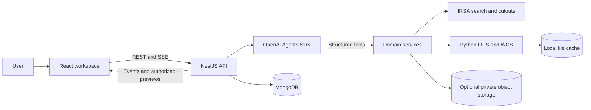

# Architecture and data flow

## Components

| Layer | Implementation | Responsibility |
| --- | --- | --- |
| Frontend | React, TypeScript, Vite | Search, image workspace, chat and shared controls |
| UI state | React feature hooks and API state | Draft input, playback, composition and committed session state |
| Backend | NestJS, TypeScript | REST, SSE, validation, ownership and integrations |
| Copilot | `@openai/agents`, Zod | Natural-language requests and domain tools |
| Database | MongoDB replica set, Mongoose | Sessions, views, searches, jobs, sequences, notes and history |
| Imaging | Python, Astropy, reproject, NumPy | FITS, WCS, common-grid images and exploratory analysis |
| Files | Local cache; optional private S3-compatible storage | FITS, PNG, radiance arrays and manifests |
| Repository | pnpm monorepo | Shared contracts and verification commands |

Earlier proposals included Zustand/TanStack Query and leased distributed workers; do not treat those as implemented dependencies. Python handles numerical imaging; the public API and agent remain in NestJS. Atlas manages its own replication; local development can use a single-node replica set.



## Repository structure

`apps/web` contains feature-based UI modules. `apps/api/src/modules` contains domain services, agent, catalogues, storage and maintenance. `packages/contracts` owns Zod/TypeScript contracts. `workers/imaging` contains Python processing and tests. `config/spherex-releases.json` defines supported Level 2 releases. Large FITS, private configuration and keys stay out of Git. Demonstration datasets need source manifests and reproducible preparation.

## Archive access

Search uses IRSA SIA2; cutouts use the archive service. Releases are explicit and never merged automatically. The current release catalogue configures DR1 and QR3; it is the application source of truth rather than an assertion that these are the only releases available externally.

Example query shape (illustrative center, not a confirmed current target position):

```text
GET https://irsa.ipac.caltech.edu/SIA
  ?COLLECTION=spherex_qr3
  &POS=CIRCLE%20133.79513%20-7.24515%200.05
  &RESPONSEFORMAT=VOTABLE
```

The SIA circle radius is in degrees; application `fovDeg` is the square field width. The adapter searches a region covering the field corners and normalizes metadata into application contracts. It preserves source identifiers, release, calibration information, times and time scales, detectors, spectral ranges, coverage and URLs. Reprocessed duplicates should not become fake epochs: observation time, not publication time, defines ordering.

Source URLs are restricted to approved HTTPS archive paths. The backend constructs cutout requests; a multi-extension FITS file requires numerical interpretation before browser display. See [archive access](https://caltech-ipac.github.io/spherex-archive-documentation/spherex-data-access/) and [cutouts](https://irsa.ipac.caltech.edu/data/SPHEREx/docs/cutout_tool.html).

## Image preparation

1. Validate ICRS degree coordinates: RA `[0,360)`, Dec `[-90,90]`, field size and UTC date order.
2. Query metadata and retain provenance, distinct products, timestamps and release.
3. Select observations and retrieve size/time-limited FITS cutouts.
4. Read image, ZODI, variance, flags, spatial WCS and spectral WCS.
5. Subtract ZODI and reproject onto a common TAN grid; preserve missing coverage.
6. Apply shared contrast for the selected sequence and produce PNG/radiance assets.
7. Persist the manifest and assets before marking the sequence ready.

The current `tan-all-wavelengths-multiband-v5` playback keeps readable observations covering the field center across wavelengths, with per-frame coverage. Earlier versions selected a spectrally matched subset. A detector is not one exact wavelength; SPHEREx variable filters do not provide 102 simultaneous images everywhere. Current dates/wavelengths and warnings are essential to interpretation. See the [integration report](12-integracja-live.md) for quality policy and analysis behavior.

Empty coverage is not zero flux. Reprojection/shared contrast alone do not establish photometric comparability, matched PSFs, or a confirmed moving object.

## Jobs and concurrency

The implemented preparation queue is local and requires one API process. Jobs persist status and progress; restart fails orphaned unfinished work explicitly. States are `queued → running → ready | failed | cancelled`. The browser polls preparation status while chat can finish independently. Cancellation propagates to downloads and child processing. Worker programs and argument arrays are fixed by the application, not shell commands supplied by a model.

The original scalable design proposed atomic MongoDB job claims using `findOneAndUpdate`, lease ownership, heartbeat, `leaseToken`/`leaseUntil`, token-checked completion and retries. This remains a design for future distributed execution; do not scale the current API horizontally on that assumption. Output publication should remain atomic and retries should not duplicate sequence results.

## Limits and caching

Current search returns at most 500 products; the former 24-frame preparation limit has been removed. Preview grids are 256×256. FOV accepts up to 2°, but large live cutouts remain subject to archive availability; larger fields are not mosaics. Downloads allow four concurrent requests, with response-size limits, timeouts and retries. The recorded large-field limit is 128 MiB above 0.5° versus 32 MiB for smaller cutouts.

Projection cache keys include source file identity/size/mtime, region, grid and worker-code hash. Corrupt cache entries are recomputed; scientific analyses use source FITS. Optional object storage keys FITS by the full cutout URL and persists sequence assets privately. Ownership is checked before serving assets. See [README](../README.md#cache-and-persistence) for cleanup and storage configuration.

Original planning values (0.5° maximum, 24 frames, 512×512 previews and a seven-day file cache) were estimates and are superseded by current contracts/configuration. Agent and image processing have separate bounds; a long-running image job must not hold a model transaction open.
