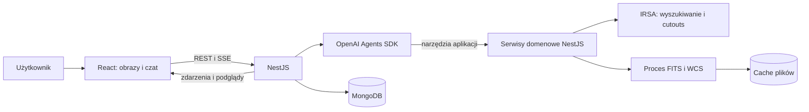

# Architektura i przepływ danych

## Proponowany stos

| Warstwa | Wybór | Zadanie |
| --- | --- | --- |
| Frontend | React + TypeScript + Vite | Formularze, czat, odtwarzacz Canvas, synchronizacja widoków |
| Stan UI | Zustand; TanStack Query dla REST | Oddzielenie stanu widoku od danych serwera |
| Backend | NestJS + TypeScript | REST, SSE, sesje, walidacja, integracje |
| Agent | `@openai/agents` + Zod | Polecenia tekstowe i wywoływanie funkcji backendu |
| Baza | MongoDB Atlas Free + Mongoose (`@nestjs/mongoose`) | Kolekcje sesji, wyszukiwań, zadań, sekwencji i adnotacji; obrazy poza bazą |
| Obrazy | Proces pomocniczy Python: Astropy + reproject + NumPy | FITS, WCS i przygotowanie wspólnej siatki klatek |
| Pliki | Wolumen lokalny w MVP; adapter do magazynu obiektowego później | Cache FITS oraz podglądy PNG/WebP |
| Repozytorium | Monorepo pnpm | Wspólne kontrakty i jedna konfiguracja CI |

React, NestJS, MongoDB i Agents SDK są wymaganiami użytkownika. Pozostałe elementy to proponowane decyzje. NestJS łączy się z MongoDB przez `MongooseModule`; schematy dokumentów, walidacja i indeksy są definiowane w modułach backendu. [NestJS: MongoDB i Mongoose](https://docs.nestjs.com/techniques/mongodb).

Użytkownik wybrał MongoDB Atlas na darmowym planie. Własny lokalny replica set jest opcją developerską; w Atlas replikacją zarządza dostawca. Gotowa konfiguracja szkieletu i granice obecnej implementacji: [uruchomienie i Atlas](11-uruchomienie-i-atlas.md).

Pomocniczy Python obsługuje wyłącznie obrazy; całe publiczne API i agent pozostają w NestJS. Astropy udostępnia transformacje WCS, a reproject reprojekcję danych astronomicznych. [Astropy WCS](https://docs.astropy.org/en/stable/wcs/), [reproject](https://docs.astropy.org/projects/reproject/en/stable/).

Powód tej propozycji: poprawne porównanie FITS wymaga interpretacji współrzędnych i metadanych. Jeżeli projekt ma używać wyłącznie TypeScript, zadanie D03 musi najpierw potwierdzić alternatywną bibliotekę FITS/WCS na rzeczywistych danych.



## Moduły i struktura docelowa

```text
apps/
  web/src/           # features: search, viewer, timeline, chat, annotations
  api/src/modules/   # sessions, observations, sequences, jobs, agent, shares, health
packages/
  contracts/         # schematy Zod i typy REST/SSE
  config/            # konfiguracja TypeScript, lintowania
workers/
  imaging/           # kod Python, testy WCS i renderowania
data/
  manifests/         # małe manifesty pochodzenia zestawów demo
docs/
```

Duże FITS i klucze nie trafiają do Git. Zestawy demo mają manifest oraz odtwarzalny skrypt przygotowania.

## Integracja archiwum

SPHEREx udostępnia obecnie wydania QR2 i QR3. Wyszukiwanie obrazów prowadzi przez SIA2, a pliki można przycinać usługą IRSA. Adapter zapisuje wydanie w każdym wyniku i nie łączy wydań automatycznie. [IRSA SPHEREx](https://irsa.ipac.caltech.edu/Missions/spherex.html), [IRSA Data Access](https://caltech-ipac.github.io/spherex-archive-documentation/spherex-data-access/).

Przykładowy kształt zapytania adaptera; współrzędne są przykładowym centrum, nie potwierdzoną aktualną pozycją obiektu:

```text
GET https://irsa.ipac.caltech.edu/SIA
  ?COLLECTION=spherex_qr3
  &POS=CIRCLE%20133.79513%20-7.24515%200.05
  &RESPONSEFORMAT=VOTABLE
```

Promień `POS` jest w stopniach; `fovDeg` aplikacji oznacza szerokość kwadratowego pola. Adapter oblicza obszar wyszukiwania obejmujący narożniki pola. Wyniki normalizuje do kontraktów aplikacji. Schemat odpowiedzi i dokładne filtrowanie spektralne należy sprawdzić w D01; nie zakładać istnienia pola „band” w dowolnym formacie.

Źródłowy `access_url` służy do pobrania FITS. Dla dozwolonych adresów archiwum backend buduje żądanie wycinka z centrum i rozmiarem. FITS z wieloma rozszerzeniami nie jest gotowym obrazkiem dla przeglądarki. [Dokumentacja cutout](https://irsa.ipac.caltech.edu/data/SPHEREx/docs/cutout_tool.html).

## Przygotowanie sekwencji

1. Zweryfikować RA w `[0,360)`, Dec w `[-90,90]`, dodatni rozmiar pola i kolejność dat. Współrzędne wejściowe: ICRS w stopniach; czas wejściowy: ISO 8601 UTC.
2. Wyszukać metadane. Zachować oryginalny identyfikator, wydanie, wersję kalibracji, pokrycie, detektor, zakres spektralny, czas i jego skalę.
3. Odrzucić powtórzenia tego samego produktu po ponownym przetworzeniu. Kolejne epoki ustalać według czasu obserwacji, nie czasu publikacji.
4. Wybrać porównywalne pokrycie spektralne i odrębne czasy; UI opisuje grupę, której używa. Sam numer detektora nie wystarcza jako dowód zgodności długości fali.
5. Pobrać ograniczone wycinki, odczytać właściwe rozszerzenia obrazu, maski jakości, niepewności i WCS. Brak niezbędnego WCS blokuje porównanie.
6. Przeprojektować klatki na tę samą siatkę nieba, rozmiar i orientację. Zachować maskę brakującego pokrycia; puste piksele nie są zerowym strumieniem.
7. Ustalić wspólne granice i funkcję rozciągania jasności dla całej sekwencji. Indywidualne skalowanie klatek może służyć do oglądania, ale musi być oznaczone.
8. Wygenerować podglądy i manifest parametrów. Dopiero wtedy zwrócić stan `ready` i zezwolić na animację.

SPHEREx używa filtrów o zmiennej długości fali: nie projektować danych jako 102 gotowych, jednoczesnych zdjęć każdego miejsca. Dla MVP akceptować tylko klatki z ustaloną tolerancją pokrycia spektralnego. Tolerancję, maskowanie i wybór HDU dokumentuje eksperyment D02/D03, a nie model językowy. [IRSA: opis obserwacji i pasm](https://irsa.ipac.caltech.edu/onlinehelp/spherex/spherex/overview.html).

## Wykonywanie zadań

W MVP zadania są dokumentami w kolekcji `jobs` w MongoDB. Worker przejmuje zadanie atomowym `findOneAndUpdate`, sprawdzając status i termin lease, a następnie zapisując właściciela, nowy `leaseToken` i `leaseUntil`. Uruchamia stały program Python z argumentami jako tablica i zapisuje rezultat. Bez poleceń shell generowanych z wejścia użytkownika. Limit czasu, pamięci i rozmiaru plików obowiązuje również dla procesu potomnego.

Stany: `queued → running → ready | failed | cancelled`. Zadanie ma lease/heartbeat; po restarcie osierocony `running` wraca do kolejki albo kończy się błędem. Heartbeat i zapis rezultatu wymagają zgodnego `leaseToken`, aby stary worker nie nadpisał wyniku po ponownym przejęciu zadania. Wyniki trafiają pod tymczasową nazwę i są publikowane atomowo. Ponowienie nie tworzy duplikatu sekwencji.

Przeglądarka odpyta status przygotowania co 1–2 s; strumień czatu nie czeka na wielominutowe przetwarzanie. Agent dostaje `jobId`, a UI samo otwiera wynik zadania przypisanego do żądania. Kolejka Redis/BullMQ jest rozszerzeniem przy większej skali.

## Cache i limity startowe

To wartości projektowe do sprawdzenia po pomiarach:

- Pole 0,1° domyślnie, maksymalnie 0,5°; maksymalnie 24 klatki, domyślnie 8.
- Podgląd do 512 × 512 px; jedno aktywne przygotowanie i jeden agent run na sesję.
- Wyszukiwanie do 20 s; przygotowanie do 120 s; najwyżej 2 ponowienia przejściowego błędu z opóźnieniem.
- Cache metadanych 15 min; plików 7 dni z limitem miejsca i usuwaniem najdawniej używanych.
- Klucz cache: identyfikator i wersja produktu + region + siatka + wybór spektralny + parametry renderowania + wersja pipeline.
- Przekroczenie limitu wyników zwraca `truncated=true`; użytkownik zawęża zapytanie. Brak cichego pobrania całego przeglądu.

Różnicowanie obrazów i ilościowe pomiary wymagają dodatkowo zgodności kalibracji, jednostek, tła i PSF; są poza P0. Reprojekcja i wspólne skalowanie same nie gwarantują poprawnego pomiaru.
