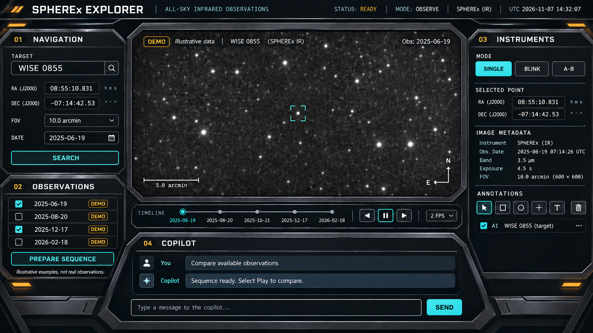

# Interfejs — nowoczesny kokpit

## Kierunek zaakceptowany przez użytkownika

Interfejs inspirowany kokpitem nowoczesnego kosmicznego myśliwca w klimacie X-winga. Punktem odniesienia jest szkic użytkownika: duży centralny ekran, boczne konsole oraz dolny panel obsługi. Całość ma sprawiać wrażenie stanowiska pilota prowadzącego obserwację nieba.

Układ i stylistyka są wymaganiem użytkownika. Poniższe kolory, proporcje i nazwy komponentów stanowią propozycję wykonania. Makieta poglądowa służy ocenie wyglądu; przedstawione na niej gwiazdy, wartości i komunikaty są ilustracyjne. Obserwacje w działającej aplikacji pochodzą z IRSA.

## Materiały projektowe



- [Szkic użytkownika](assets/kokpit-szkic.jpg).
- [Makieta w pełnej rozdzielczości](assets/kokpit-koncepcja-v1.png), wygenerowana wbudowanym narzędziem imagegen z referencją do szkicu.
- Dokładne prompty: [generowanie makiety](assets/kokpit-prompt.txt) oraz [korekta przykładowych wartości i listy obserwacji](assets/kokpit-prompt-korekta.txt).

Makieta przedstawia kierunek stylistyczny. Lista kontrolek i ich zachowanie z dalszej części dokumentu są specyfikacją implementacji, również dla elementów niewidocznych na obrazie. Język angielski na makiecie jest przykładowy; aplikacja zachowuje planowaną obsługę PL/EN.

## Kompozycja desktopowa

```text
┌───────────────────────────────────────────────────────────────────────────┐
│ SPHEREx EXPLORER     obiekt / współrzędne      status danych     PL / EN   │
├──────────────┬─────────────────────────────────────────┬──────────────────┤
│ NAWIGACJA    │                                         │ INSTRUMENTY      │
│ Obiekt       │           GŁÓWNY EKRAN NIEBA             │ Tryb obrazu      │
│ RA / Dec     │                                         │ Metadane         │
│ Pole / daty  │       obraz / blink / porównanie A/B     │ Zaznaczony punkt │
│ Szukaj       │                                         │ Notatka          │
│ Obserwacje   │                                         │ Źródła / jakość  │
├──────────────┼─────────────────────────────────────────┼──────────────────┤
│ STATUS       │       OŚ CZASU + PLAY / PAUSE + TEMPO    │ OPERACJE         │
│ źródło       ├─────────────────────────────────────────┤ postęp / anuluj  │
│ wydanie      │ COPILOT: rozmowa i polecenie tekstowe    │ zapis / link     │
└──────────────┴─────────────────────────────────────────┴──────────────────┘
```

Na szerokim ekranie: lewa konsola około 240 px, prawa około 260 px, środek zajmuje pozostałą szerokość. Centralny obraz jest największym elementem. Dolna konsola zajmuje około 180–240 px wysokości i może się rozszerzać na żądanie. To wartości startowe, do sprawdzenia na rzeczywistych kontrolkach.

Zewnętrzna rama może mieć ścięte narożniki i lekko ukośne krawędzie jak na szkicu. Wewnętrzny obraz, tekst i formularze zachowują prostą geometrię. Ozdobna rama nie zasłania pikseli obserwacji ani nie przechwytuje kliknięć. Widok pełnoekranowy pozwala powiększyć sam obszar danych.

## Podział funkcji

| Panel | Zawartość i kontrolki |
| --- | --- |
| Górny pasek | Nazwa aplikacji, bieżący obiekt, rzeczywisty stan połączenia i tryb live/demo, język |
| Lewa konsola „Nawigacja” | Przykłady obiektów, RA/Dec, rozmiar pola, daty, wyszukiwanie; lista obserwacji z checkboxami i „Przygotuj sekwencję” |
| Centralny ekran | Obraz i znaczniki, skala kątowa, orientacja, daty klatek, zoom +/−, przesuwanie, „Dopasuj obraz”; tryb A/B ze wspólnym zoomem |
| Prawa konsola „Instrumenty” | Przełącznik pojedynczy/blink/A/B, filtry spektralne z opisem zgodności, metadane, jakość danych i źródła |
| Prawa konsola „Zaznaczenie” | Współrzędne klikniętego punktu, „Wyczyść”, tekst i zapis notatki, lista notatek |
| Dolna oś czasu | Wybór klatki, poprzednia/następna, play/pause i tempo; widoczne daty i nierówne odstępy czasu |
| Dolna konsola „Copilot” | Historia czatu, pole wpisywania polecenia, „Wyślij”, „Stop”, stan narzędzi; rozwijany pełny zapis rozmowy |
| Panel operacji | Postęp przygotowania, „Anuluj”, ponowienie błędu, „Udostępnij widok” |

Każde narzędzie agenta ma odpowiednik ręczny: wybór celu, wyszukiwanie, przygotowanie sekwencji, ustawienie widoku i odtwarzania, wybór punktu oraz zapis adnotacji. Powodzenie operacji aktualizuje wspólny stan, niezależnie od tego, czy uruchomił ją użytkownik przyciskiem czy agent.

## Zmiany agenta pozostają edytowalne

To wymaganie użytkownika: po działaniu agenta wszystkie odpowiadające mu kontrolki pokazują nowe wartości i pozwalają je dalej zmieniać ręcznie. Nie tworzymy oddzielnego, ukrytego zestawu ustawień dla czatu.

| Agent wykonuje | Użytkownik widzi i może poprawić |
| --- | --- |
| Wyszukuje wskazany obiekt i okres | Nazwę celu, RA/Dec, pole i daty wpisane w formularzu |
| Wybiera obserwacje do sekwencji | Zaznaczone checkboxy tych obserwacji |
| Włącza porównanie | Aktywny przełącznik blink/A/B i wybrane klatki |
| Zmienia tempo lub zatrzymuje odtwarzanie | Aktualną wartość suwaka oraz stan play/pause |
| Korzysta z zaznaczonego punktu i zapisuje notatkę | Ten sam znacznik i nową pozycję na liście notatek |

Użytkownik może np. zmniejszyć tempo z 2 do 1 klatki/s albo zmienić wybrany zakres dat. Tempo działa od razu; zmienione daty czekają na „Szukaj”, a wybór obserwacji na „Przygotuj sekwencję”. Widok jasno odróżnia parametry wyświetlanych obrazów od zmienionego formularza.

Pola zmienione przez agenta mogą otrzymać krótkie, subtelne podświetlenie i opis „Zmienione przez copilota”. Oznaczenie znika po chwili; aktualne wartości pozostają. Użytkownik nie musi zatwierdzać samego faktu, że kontrolki odzwierciedlają wykonaną operację.

Ręczna edycja ma ochronę przed spóźnionym wynikiem agenta: niedokończony wpis nie znika, a nowszych wartości nie zastępuje starsza operacja. Po odświeżeniu strony kontrolki odtwarzają ostatni zatwierdzony stan. Przy kolejnym poleceniu agent dostaje aktualne ustawienia, wraz z ręcznymi poprawkami.

## Styl wizualny

| Element | Propozycja |
| --- | --- |
| Tło aplikacji | Prawie czarny grafit `#080D14` |
| Konsole | Ciemny granat `#111B28`; podniesiona powierzchnia `#192638` |
| Obramowania | Stalowy `#33465E`, cienkie linie, delikatny cień i punktowe rozjaśnienie krawędzi |
| Akcent sterowania | Cyjan `#5DDDEB`: aktywny panel, fokus, zaznaczenie |
| Akcent ostrzegawczy | Bursztynowy `#F6B85A`: ograniczenia danych, niezgodność i operacje wymagające uwagi |
| Tekst | Główny `#E8F0F8`, pomocniczy `#A5B6C9` |
| Błąd | Czerwony `#FF818A`, zawsze z ikoną i opisem |
| Typografia | Czytelny sans-serif do interakcji i czatu; monospace do RA/Dec, dat oraz wartości liczbowych |
| Kształty | Zewnętrzne ścięcia ram, zwarte przełączniki, oszczędne podziały sekcji; formularze z czytelnymi etykietami |

Cyjan i bursztyn dotyczą kontrolek. Paleta wizualizacji danych astronomicznych pozostaje niezależna od motywu kokpitu. Znacznik wybranego punktu można ukryć, aby nie zasłaniał obiektu.

## Ruch i informacja zwrotna

- Krótkie przejścia aktywnego przycisku i panelu, około 120–180 ms; respektować `prefers-reduced-motion`.
- Ładowanie ma rzeczywisty stan: wyszukiwanie → pobieranie → przygotowanie → gotowe. Gdy procent jest nieznany, pokazywać etap i upływ czasu.
- Animacja nieba startuje po świadomym poleceniu; pauza pozostaje zawsze dostępna.
- Bez ciągłego migotania, efektu uszkodzonego ekranu, scanlines i dekoracyjnego radaru udającego pomiar.
- Dźwięki interfejsu nie należą do MVP. Domyślnie aplikacja jest cicha.

## Responsywność i dostępność

- Od około 1440 px: pełny kokpit z dwiema konsolami bocznymi.
- Poniżej około 1280 px: panele boczne zwijane do zakładek, większa powierzchnia obrazu.
- Na telefonie: obraz, obserwacje, copilot i szczegóły jako przełączane zakładki; dolny pasek odtwarzania pozostaje pod ręką. Dekoracja kokpitu jest uproszczona.
- Pola tekstowe i przyciski mają standardowe zachowanie, widoczny fokus, nazwy dostępne dla czytników i obsługę klawiaturą. Żadna informacja nie jest kodowana wyłącznie kolorem.
- Tekst podstawowy co najmniej 14 px, czat najlepiej 16 px; nie pomniejszać danych, aby zmieścić ozdobne elementy. Kontrast oraz powiększenie strony wymagają weryfikacji przy implementacji.
- Pole czatu przechwytuje skróty tylko podczas wpisywania; skróty odtwarzacza nie zakłócają pisania.

## Wskazówki do React

Docelowe komponenty: `CockpitShell`, `NavigationConsole`, `ObservationViewport`, `InstrumentConsole`, `TimelineControls`, `CopilotConsole`, `OperationStatus` i `AnnotationPanel`.

Układ wykonać CSS Grid, ozdobne krawędzie CSS/SVG, obrazy Canvas. Tekst, formularze i czat pozostają elementami DOM. Tokeny kolorów i odstępów zdefiniować jako zmienne CSS. Efekty świetlne są delikatne i nie wpływają na naukowy obraz. Pełny kokpit nie wymaga sceny WebGL ani trójwymiarowego modelu statku.

Makieta rastrowa nie stanowi tła dla całej aplikacji: kontrolki muszą być rzeczywistymi komponentami, responsywnymi i dostępnymi.

## Kryteria odbioru wyglądu

1. Rozpoznawalny układ ze szkicu: główny ekran, boczne konsole i dolny panel.
2. Największą uwagę przyciąga obserwacja; etykiety i daty pozostają czytelne.
3. Cały główny scenariusz można przejść ręcznie i przez czat; oba sposoby pokazują ten sam stan.
4. Ładowanie, puste wyniki, błąd i anulowanie mają dopracowane widoki w motywie kokpitu.
5. Na małym ekranie i przy powiększeniu strony kontrolki pozostają dostępne, bez ściskania desktopowego kokpitu.
